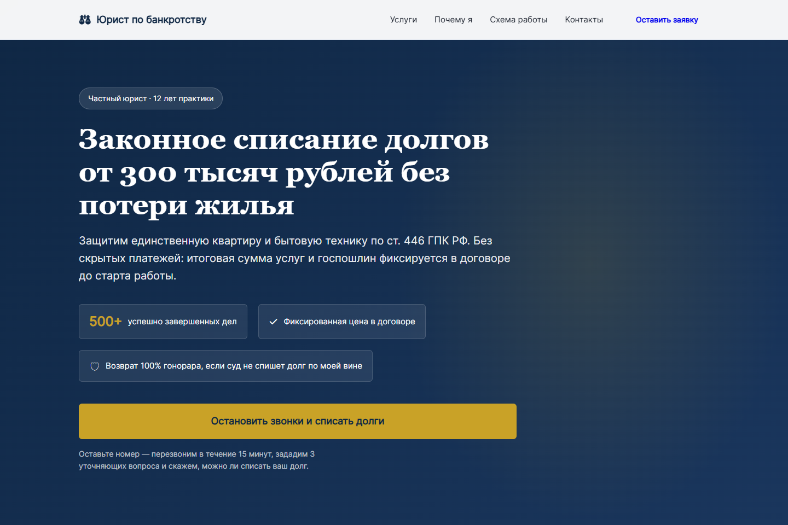
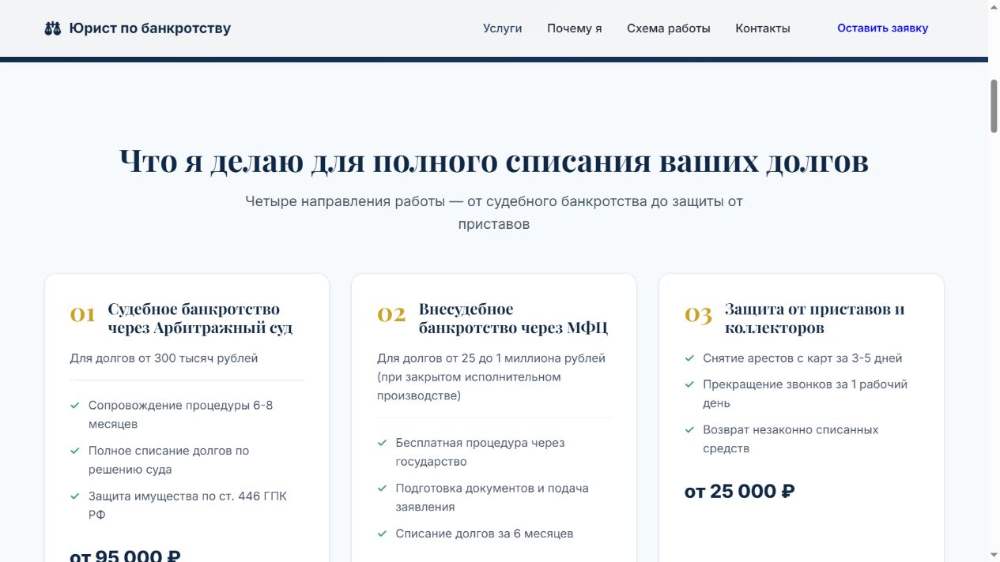
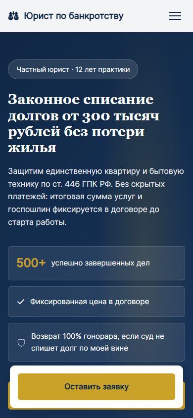

# Лендинг юридических услуг

Адаптивный лендинг с услугами, этапами работы, FAQ и формой обращения.

[Все проекты](https://github.com/gek-finn)

## Задача

Представить услуги специалиста и собрать обращение на первичную консультацию.

## Что реализовано

- Первый экран с предложением консультации.
- Описание услуг и этапов работы.
- Блоки доверия и ответы на вопросы.
- Мобильная версия и навигация по разделам.
- Проверка имени, телефона и выбранной суммы в форме.

## Технологии

HTML · CSS · JavaScript

## Статус и ограничения

Демонстрационный макет, не юридическая консультация. Тексты о гарантиях и результатах в исходном макете требуют проверки перед коммерческим использованием. Отправка заявок в портфельной копии отключена.

## Интерфейс

### Первый экран

### Раздел услуг

### Мобильная версия

## Запуск

Откройте `index.html` в браузере. Для просмотра на localhost: `python -m http.server 8080 --bind 127.0.0.1`.

## О кейсе

Описание показывает реализованные функции. Подтверждённые показатели продаж, экономии времени и коммерческого внедрения в этом кейсе не заявляются.
